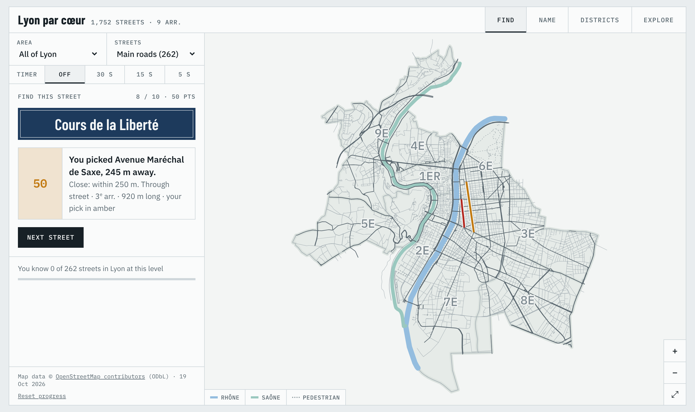
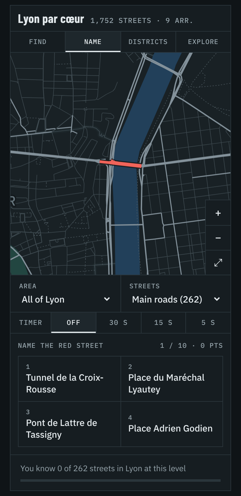

# Lyon Streets

A map quiz for learning the streets and arrondissements of Lyon. Find a street on a blank map, name a highlighted street, tap the right district, or browse the city in Explore mode. An optional timer adds a speed bonus.

It's a single static page with no backend or tracking, and only one external request (Google Fonts). Progress is kept in each visitor's browser.



<p align="center"></p>

## Features

- **Find:** you're given a street name and click it on the map. Pointing at a street highlights it before you answer; on touch screens, the first tap selects and the second confirms.
- **Name:** a street is highlighted in red and you pick its name from four nearby streets.
- **Districts:** tap the arrondissement asked for, with the labels hidden.
- **Explore:** search for a street or tap one to see its district, type and length.
- **Filters:** practise one arrondissement at a time, at three levels: "Main roads" (262), "+ Well-known streets" (655) or "Every street" (1,752).
- **Timer:** off, 30 s, 15 s or 5 s per question, started with a Start button.
- **Spaced repetition:** missed streets come back more often, and a progress bar tracks the streets you know.
- **Themes:** light and dark, following the system setting. Works on phones.

### Scoring

| Find mode | Points |
|---|---|
| Right street | 100 |
| Another street within 250 m | 50 |
| Wrong street, right arrondissement | 20 |
| Anywhere else | 0 |

Name and Districts modes score 100 for right and 0 for wrong.

With the timer on, an answer within 3 seconds keeps full points. After that, points slide gradually to 70% at the buzzer, so a right answer is always worth at least 70. Wrong answers get no speed bonus, and running out of time scores 0. A street counts as "known" when its last score is 70 or more.

## Run it locally

You need Python 3.8 or later (standard library only):

```sh
python3 scripts/build.py          # writes dist/index.html
python3 -m http.server -d dist    # then open http://localhost:8000
```

You can also open `dist/index.html` directly in a browser.

## Deploy

The Dockerfile builds the page in a Python stage and serves it with nginx on **port 80**.

```sh
docker build -t lyon-streets .
docker run --rm -p 8080:80 lyon-streets      # http://localhost:8080
```

**Dokploy:** create an Application from this GitHub repository (or upload a zip of it with the Drop option). Set the build type to **Dockerfile**, with Dockerfile path `Dockerfile` and context `.`, then add a domain on port 80.

**Any static host** (GitHub Pages, Netlify, an S3 bucket…): run `scripts/build.py` and upload `dist/index.html`. It's the only file needed.

## Project layout

```
src/template.html       the page (HTML, CSS, JS) with a __DATA__ placeholder
data/lyon-data.json     processed street and district data (~200 KB)
scripts/build.py        template + data -> dist/index.html
scripts/process.py      raw OpenStreetMap export -> data/lyon-data.json
deploy/nginx.conf       nginx config used by the Dockerfile
Dockerfile              two-stage build: Python builds the page, nginx serves it
```

## Refresh the street data

The data comes from OpenStreetMap through the [Overpass API](https://overpass-turbo.eu). The current file was exported on 19 October 2026.

1. On [overpass-turbo.eu](https://overpass-turbo.eu), run this query:

   ```
   [out:json][timeout:180];
   area["name"="Lyon"]["admin_level"="8"]->.lyon;
   (
     way(area.lyon)["highway"~"^(trunk|primary|secondary|tertiary|residential|unclassified|living_street|pedestrian)$"]["name"];
     relation(area.lyon)["boundary"="administrative"]["admin_level"="9"];
   );
   out geom;
   ```

   If it fails with "error (0)", the server is busy: change the Overpass server in Settings, for example to `https://overpass.kumi.systems/api/`.

2. Export the **raw data** as JSON (the file with an `elements` list), not GeoJSON. Save it as `export.json` in the project folder; `.gitignore` keeps it out of the repository.

3. Process it and rebuild:

   ```sh
   python3 scripts/process.py export.json
   python3 scripts/build.py
   ```

   The street count in the header and the date in the footer update automatically.

4. Check the map. The Rhône and Saône are drawn from the arrondissement borders that run down the rivers, plus a few border segments chosen by OpenStreetMap way ID (`RIVER_EXTRA_WAYS` in `process.py`). If OSM editors have split or renumbered those, the script prints a warning and that stretch of river goes missing; update the IDs to fix it.

## Known limitations

- **The rivers are approximate.** They're drawn along administrative borders, not from water outlines, so they're right for orientation but not to the metre.
- **The difficulty levels are a heuristic, not a ranking by fame.** "Main roads" means OSM main roads or streets of 900 m or more. "+ Well-known streets" adds OSM tertiary roads and streets of 350 m or more. Some famous short streets, such as Rue du Bœuf and Rue Juiverie, only appear under "Every street".
- **Only arrondissements are covered**, not quartiers (Croix-Rousse, Part-Dieu, Monplaisir…).
- **Progress stays in one browser.** Scores live in `localStorage`, so they don't sync between devices and are lost if the browser's site data is cleared.

## Licence

The code (`src/`, `scripts/`, `deploy/`, `Dockerfile`) is released under the [MIT Licence](LICENSE).

The street and district data in `data/` is derived from OpenStreetMap and is available under the [Open Database Licence (ODbL) 1.0](https://opendatacommons.org/licenses/odbl/1-0/). See [data/LICENSE.md](data/LICENSE.md).

Map data © [OpenStreetMap contributors](https://www.openstreetmap.org/copyright). The page shows this credit in its footer; keep it if you reuse the data.
